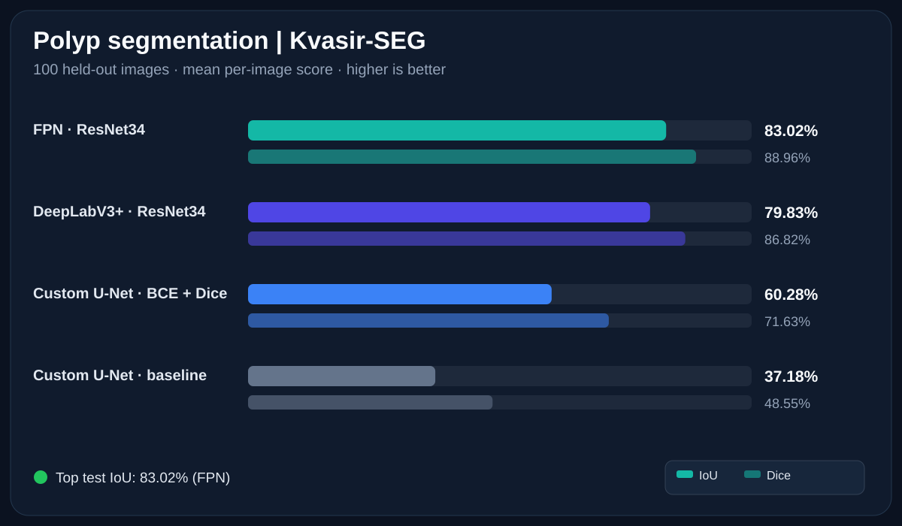
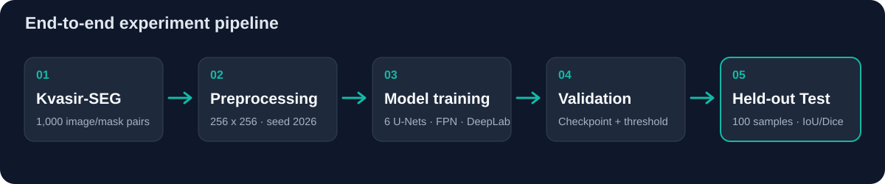
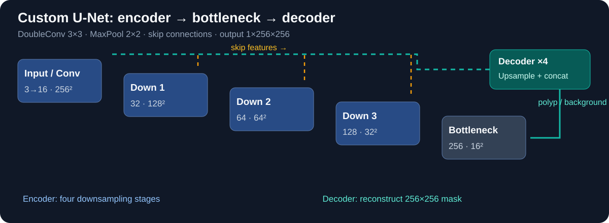

# Polyp Segmentation with Deep Learning

**Семантическая сегментация полипов на эндоскопических изображениях — собственная U-Net и сравнение с FPN / DeepLabV3+.**

Python · PyTorch · Computer Vision · Medical Imaging · Transfer Learning · Kaggle



## О проекте

Разработал и обучил **собственную свёрточную сеть U-Net** для бинарной сегментации полипов на эндоскопических снимках. Провёл **6 контролируемых экспериментов** с архитектурой и обучением, затем сравнил лучшую U-Net с двумя готовыми архитектурами — **FPN** и **DeepLabV3+** на базе **ResNet34**, предобученной на ImageNet.

На вход сеть получает RGB-изображение, на выходе — попиксельную маску из двух классов: **полип / фон**. Качество оценивается на одинаковой отложенной тестовой выборке; порог сегментации подбирается **только по validation**.

### Результаты на 100 тестовых изображениях

| Модель | Mean IoU | Mean Dice |
|:--|--:|--:|
| Собственная U-Net — baseline | 37,18% | 48,55% |
| Собственная U-Net — BCE + Dice | **60,28%** | **71,63%** |
| DeepLabV3+ · ResNet34 | 79,83% | 86,82% |
| **FPN · ResNet34** | **83,02%** | **88,96%** |

Улучшенная U-Net превзошла базовую на **23,10 процентного пункта IoU**. Лучший результат эксперимента — **FPN (IoU 83,02%)**. Метрики — средние по изображениям (*mean per-image*), полученные в одном экспериментальном разбиении; это не клиническая оценка.

## Как устроено решение



**Данные:** [Kvasir-SEG](https://www.kaggle.com/datasets/debeshjha1/kvasirseg) — 1 000 изображений и соответствующих масок. Деление: 800 / 100 / 100 (train / validation / test), `seed=2026`, размер входа `256×256`, `batch_size=4`.



Собственная модель содержит четыре уровня уменьшения и восстановления разрешения, блоки `DoubleConv(3×3)`, `MaxPooling(2×2)`, skip-connections между кодером и декодером и выходную свёртку `1×1`. Для готовых моделей использован encoder ResNet34 с предварительным обучением на ImageNet.

### Эксперименты с U-Net

| ID | Проверяемое изменение | Validation IoU |
|:--|:--|--:|
| E0 | Базовая U-Net, взвешенная BCE | 36,18% |
| E1 | Batch Normalization + Dropout2d | 40,13% |
| **E2** | **BCE + Dice Loss** | **57,07%** |
| E3 | Аугментации геометрии и яркости | 49,07% |
| E4 | ReduceLROnPlateau | 41,89% |
| E5 | ConvTranspose2d вместо билинейного upsampling | 44,93% |

Значения в таблице — метрики **валидации после подбора порога**. Именно по валидации выбрана E2 для окончательной оценки на Test. Не все дополнительные методы улучшили результат — это часть честного экспериментального сравнения.

## Запуск в Kaggle

1. Скачайте [`notebooks/Polyp_Segmentation_Kvasir_SEG.ipynb`](notebooks/Polyp_Segmentation_Kvasir_SEG.ipynb) и импортируйте в [Kaggle Code](https://www.kaggle.com/code) через **New Notebook → File → Import Notebook**.
2. Через **Add Input** добавьте [`debeshjha1/kvasirseg`](https://www.kaggle.com/datasets/debeshjha1/kvasirseg).
3. В **Settings → Accelerator** включите GPU; для установки `segmentation-models-pytorch` и загрузки ImageNet-весов при первом запуске включите Internet.
4. Выполните **Run All**. Ноутбук сам создаст рабочий Python-модуль, проверит 1 000 пар, обучит модели, построит графики и тестовые маски.
5. После завершения скачайте `polyp_segmentation_results.zip` из `/kaggle/working/`.

> Обучение всех восьми конфигураций занимает существенное время и требует доступной квоты GPU. При повторном запуске внутри того же рабочего каталога прогресс восстанавливается по сохранённым checkpoint-файлам. На новой сессии без сохранённого `/kaggle/working` обучение начнётся сначала.

### Что лежит в репозитории

```text
semantic_segmentation_on_endoscope/
├── README.md
├── notebooks/
│   └── Polyp_Segmentation_Kvasir_SEG.ipynb    # самодостаточный Kaggle Notebook
├── src/
│   └── kvasirseg_worker.py                    # PyTorch-модели, обучение, метрики, inference
├── results/
│   ├── test_metrics.csv                      # итоговые показатели
│   ├── unet_validation.csv                   # шесть экспериментов
│   └── experiment_summary.json               # метаданные эксперимента
├── assets/
│   ├── model_comparison.svg                  # график метрик
│   ├── pipeline.svg                          # рабочий процесс
│   └── unet_architecture.svg                 # схема U-Net
├── docs/
│   └── methodology.md                        # протокол, ограничения и интерпретация
├── requirements.txt
└── .github/workflows/validate.yml
```

## Что реализовано

- Сопоставление снимков с масками, контроль количества пар и неизменности разбиения по SHA-256 fingerprint.
- Собственная U-Net на PyTorch — не вызов готовой U-Net из библиотеки.
- Взвешенная BCE, комбинированная BCE + Dice Loss, BatchNorm, Dropout, аугментации и LR scheduler.
- Сохранение checkpoint после каждой эпохи и автоматическое продолжение прерванного обучения.
- Подбор порога от `0.20` до `0.70` на Validation без подглядывания в тестовые метки.
- Сравнение на одинаковых 100 Test-изображениях: IoU и Dice, визуализация предсказанных масок, отдельный `forward()` сохранённой модели.

## Ограничения

Это **исследовательский учебный проект**, а не система медицинской диагностики. Результаты относятся к одной случайной разбивке Kvasir-SEG; данные других клиник, независимость на уровне пациентов и клиническая пригодность не проверялись. Обученные веса (~180 МБ) намеренно не включены в Git: они генерируются при запуске Notebook. Набор изображений также не перезаливается — используется исходный [Kvasir-SEG](https://www.kaggle.com/datasets/debeshjha1/kvasirseg).

---

**Владислав Гаврилов** · учебный проект по компьютерному зрению / глубокому обучению · [GitHub](https://github.com/Vlad-gw)